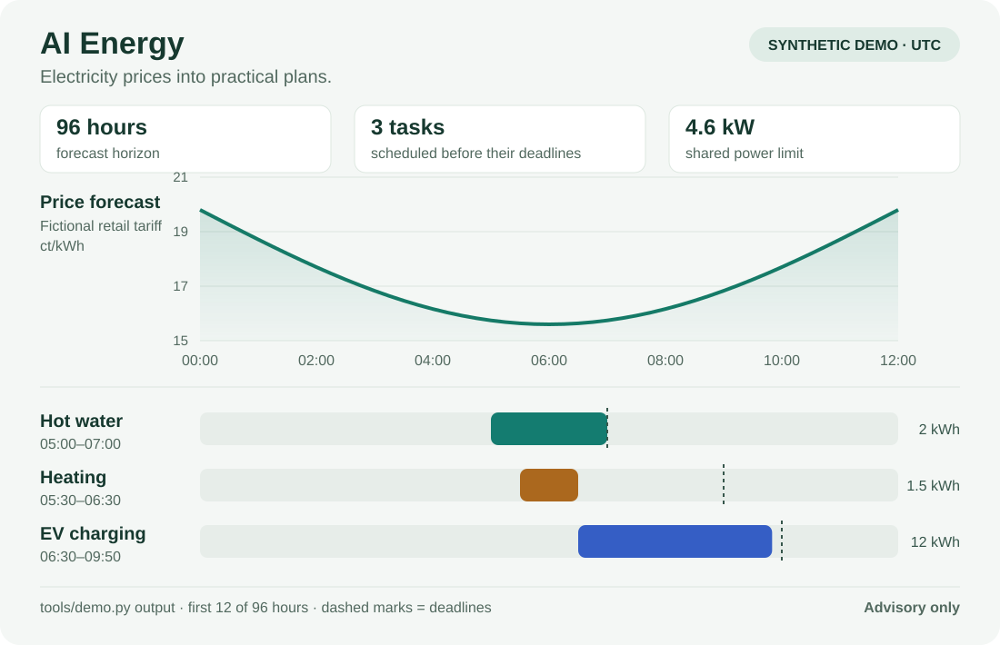

[Nederlands](README.md) | **English**

# AI Energy for Home Assistant

**Forecast electricity prices and plan flexible energy use around your deadlines.**

AI Energy combines published market prices, a model of your retail tariff and
a 96-hour forecast with scheduling for flexible loads. See which prices are
known, which are predicted, and when a task can run within the energy, power
and time limits you provide.

Built for Home Assistant users exploring dynamic electricity tariffs and EV
charging who are comfortable configuring Python and Home Assistant integrations.

**Status: `0.1.0-preview.1` — a manual-install preview.** The forecasting code
comes from a working V11 installation. The public package and its general
scheduler need configuration and validation for each new installation.
It is not a one-click HACS integration.

[Try the demo](#try-the-demo-without-home-assistant) ·
[Use with Home Assistant](#use-with-home-assistant) ·
[Optional EV recipe](#optional-ev-planner) ·
[Report your experience](#help-test-the-preview)



*Illustration of the included synthetic demo. All its prices are forecasts
from artificial history; this is not a live household dashboard or evidence
of savings or forecast accuracy.*

## What is included?

| Component | Purpose |
|---|---|
| Market forecasting | Normalize published Nord Pool / ENTSO-E prices and forecast later quarters |
| Retail learning | Learn the relationship between market prices and observed consumer tariffs |
| Archive and evaluation | Preserve issue times and evaluate forecasts against later observations |
| Advisory scheduler | Plan contiguous blocks using energy needs, deadlines, priorities and available power |
| Optional EV recipe | Home Assistant logic for sessions, deadlines, manual commands and charging limits |
| Synthetic demo | Run forecasting and scheduling locally without accounts or household data |

The general scheduler produces advice and never controls equipment. Heating
and hot-water examples use a supplied energy requirement; they do not learn
the thermal behavior of your home or boiler.

## Try the demo without Home Assistant

Use **Python 3.11 or later** and run these commands in a terminal:

```console
git clone https://github.com/yellowwiersma-creator/ai-energy-home-assistant.git
cd ai-energy-home-assistant
python -m pip install -r requirements-dev.txt
python tools/demo.py --output demo-output/demo.json
```

Alternatively, download and extract the repository, open a terminal in its
folder and run the two `python` commands. `tzdata` supplies time zones on
systems without an IANA time-zone database, including many Windows systems.

Open `demo-output/demo.json` to inspect 384 forecast quarters and plans for
three example tasks: EV charging, hot water and heating. The demo builds
28 days of artificial history, runs the actual `recent_grouped_daily` market
predictor and applies a declared fictitious retail-tariff formula.

No Home Assistant login or device connection is used. The output file must be
new; choose another filename when repeating the command. To run only the
scheduler against the included normalized example:

```console
python tools/plan.py examples/planning.example.json
```

## Use with Home Assistant

Install Pyscript, a supported market-price source and an observed retail-tariff
source separately. This preview uses a Zonneplan-oriented retail data contract;
another supplier may need an adapter, not just a different entity name.

1. Install/configure Pyscript and Nord Pool and/or a compatible ENTSO-E source.
2. Create a `local` folder and copy `examples/settings.example.json` to
   `local/settings.json`. This folder is ignored by Git and excluded from
   releases; keep your personal configuration there.
3. Edit that copy with your source entities. Check their meaning, availability
   and units, and leave `enabled` set to `false` initially.
4. Prepare a **new** staging folder using your edited settings:

   ```console
   python tools/prepare_install.py --destination install-stage --settings local/settings.json
   ```

5. Review the staged files and back up any existing installation before
   copying them into Home Assistant. The tool does not overwrite existing
   files or install charging control.
6. Complete the Pyscript setup, then enable collection locally once your
   sources and units are correct.

Follow the detailed [installation guide (Dutch)](docs/INSTALLATIE.md) for
Pyscript imports, `/config` paths and activation. The main output is
`sensor.ai_energy_v11_dashboard_data`, containing the price series, source
information and readiness status. A basic entities card can display it.

A new installation starts without learned household history. The current
market model needs at least 28 days of history; the retail learner also has
minimum data requirements. Readiness alone does not establish accuracy.
Evaluate forecasts recorded before their target time using your own data.

## Optional EV planner

The separate EV recipe retains session, deadline, manual-override and fallback
logic. Map and review its device roles for your vehicle and charger; it is not
a universal charger adapter.

```console
python tools/render_ev_planner.py --settings examples/ev-settings.example.json --output local/ev-planner.yaml
```

All generated automations and their master initialize **OFF**. The renderer
has no option to enable charging. Read the [EV guide (Dutch)](docs/EV-PLANNER.md)
before configuring your own copy. The master blocks new commands; it is not a
physical emergency stop for equipment already operating independently.

## Reading the results

- Published market prices, predictions and retail tariffs are different
  quantities. A retail estimate can remain uncertain when the market price is known.
- The general scheduler expects comparable retail prices in **EUR/kWh**;
  the HA forecast adapter explicitly uses **ct/kWh**.
- Missing prices remain missing. Zero and negative prices are valid values.
- The greedy scheduler does not guarantee a globally optimal plan across loads.
- Error metrics and demo results do not guarantee accuracy or savings.
- Using solar energy now can forgo export revenue; the PV helper compares
  that opportunity cost with later imports on the tariff basis you supply.

## Help test the preview

Trying a first installation or another price source? Share what worked and
where the instructions were unclear in a [GitHub issue](https://github.com/yellowwiersma-creator/ai-energy-home-assistant/issues).
Include relevant versions and a small synthetic example where possible.
Keep credentials, personal logs, calendars and Home Assistant backups private.

Optional local checks:

```console
python tools/run_tests.py
python tools/audit_release.py
```

See [contributing](CONTRIBUTING.md), [validation](docs/VALIDATIE.md),
[architecture](docs/ARCHITECTUUR.md) and [data formats](docs/GEGEVENSFORMAAT.md)
for more detail. These guides are currently in Dutch.

Code is licensed under [MIT](LICENSE). External integrations and data services
retain their own terms; see [NOTICE.md](NOTICE.md).
