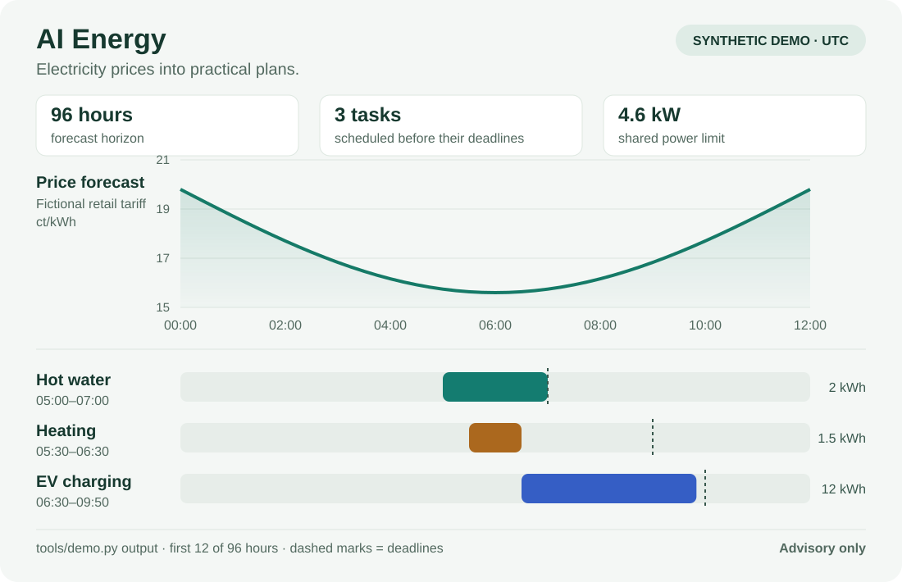

# AI Energy voor Home Assistant

**Nederlands** · [English](README.en.md)

**Plan je laadbeurt, warm water en andere flexibele taken met dynamische stroomprijzen.**

Voor Home Assistant-gebruikers die vooruit willen kijken: AI Energy maakt een
prijsvooruitblik tot 96 uur en kiest tijdvakken voor een opgegeven energiebehoefte,
deadline en vermogensgrens. Gepubliceerde prijzen en voorspellingen blijven
herkenbaar gescheiden. Je kunt de demo lokaal proberen zonder Home Assistant,
accounts of aangesloten apparaten.

**Status: `0.1.0-preview.1`.** Broncode en voorbeelden voor een nieuwe installatie.
Geen HACS-integratie met één klik. De voorspelcode is afkomstig uit een
werkende V11-installatie; de opgeschoonde installatie en algemene planner
moeten per woning worden ingericht en gecontroleerd.

[Demo proberen](#snel-proberen-zonder-home-assistant) ·
[Installeren in Home Assistant](docs/INSTALLATIE.md) ·
[EV-planner](docs/EV-PLANNER.md) ·
[Feedback geven](https://github.com/yellowwiersma-creator/ai-energy-home-assistant/issues/new/choose)



*Visualisatie van de uitvoer van `tools/demo.py`, met fictieve prijzen en taken.
Alle tijden zijn UTC. Dit is een voorbeeld van de adviesplanner; de afbeelding
is geen meegeleverd Home Assistant-dashboard of bewijs van besparing.*

## Wat zit erin?

| Onderdeel | Wat het doet |
|---|---|
| Marktmodel | Gepubliceerde Nord Pool-/ENTSO-E-prijzen normaliseren en latere marktprijzen voorspellen |
| Retailmodel | De relatie leren tussen marktprijs en het werkelijk gemeten consumententarief |
| Forecastarchief | Uitgiftemoment, bron en doelkwartier bewaren voor latere evaluatie |
| Modelcontrole | Chronologische validatie, fout per horizon en terughoudende modelkeuze |
| Algemene energieplanner | Aaneengesloten tijdvakken kiezen voor een opgegeven energiebehoefte, deadline en vermogensgrens |
| Optioneel EV-recept | Uitgebreide HA-logica voor agenda, handmatige opdrachten, sessies, laadlimieten en noodplanning |
| Synthetische demo | De keten van model naar planning laten draaien zonder accounts of woninggegevens |

De algemene planner geeft advies. De voorbeeldbehoefte voor verwarmen of warm
water is geen automatisch geleerd thermisch woningmodel. Het EV-recept bevat
apparaatacties, maar alle automatiseringen en de master staan standaard uit.

## Snel proberen zonder Home Assistant

Gebruik Python 3.11 of hoger. `tzdata` levert tijdzones op systemen zonder
IANA-tijdzonebestanden, waaronder veel Windows-installaties.

```console
git clone https://github.com/yellowwiersma-creator/ai-energy-home-assistant.git
cd ai-energy-home-assistant
python -m pip install -r requirements-dev.txt
python tools/demo.py --output demo-output/demo.json
```

Liever zonder Git? Kies bovenaan **Code → Download ZIP**, pak het uit en voer
de laatste twee opdrachten uit vanuit de uitgepakte map.

Open daarna `demo-output/demo.json`: onder `plan.loads` staan de gekozen
start- en eindtijden, geplande kWh, verwachte kosten en eventuele tekorten.
Het programma overschrijft geen bestaande uitvoer; kies bij opnieuw proberen
een andere bestandsnaam. De afbeelding hierboven toont de eerste twaalf uur
van deze reproduceerbare demo.

De demo genereert 28 dagen **kunstmatige historie**, draait daarmee het echte
`recent_grouped_daily`-marktmodel en maakt een 96-uursprijsreeks. Een expliciet
fictieve tariefformule zet deze om naar consumententarieven. Daarna plant hij
drie voorbeeldopdrachten: EV, warm water en verwarmen.

Alle demoprijzen zijn voorspellingen. De demo is een werkingstest, geen
backtest op echte marktgegevens en geen bewijs van nauwkeurigheid of besparing.

Met een eigen, genormaliseerd scenario kun je alleen de adviesplanner draaien:

```console
python tools/plan.py examples/planning.example.json
```

## Hoe helpt dit met energie plannen?

1. Verzamel marktprijzen en je werkelijk betaalde tarief op dezelfde tijdlijn.
2. Gebruik gepubliceerde prijzen waar die bekend zijn en herkenbare prognoses
   voor de resterende horizon.
3. Geef per verbruiker aan hoeveel elektrische energie nodig is, welk vermogen
   hij gebruikt, wanneer hij mag starten en wanneer hij klaar moet zijn.
4. Beoordeel de planning en controleer ontbrekende energie of een dreigende deadline.
5. Koppel pas daarna een lokale apparaatadapter, met behoud van handmatige
   bediening en apparaatbeveiligingen.

Zonne-energie is niet automatisch gratis: direct verbruiken kan betekenen dat
je terugleveropbrengst misloopt. De PV-helper vergelijkt die opbrengst met
later inkopen op dezelfde tariefbasis. Contract- en belastingregels moet je
zelf correct verwerken.

## In Home Assistant gebruiken

Volg [INSTALLATIE.md](docs/INSTALLATIE.md). De korte route:

1. Installeer/configureer Pyscript en de gewenste prijsintegraties afzonderlijk.
2. Maak de map `local` en kopieer
   [settings.example.json](examples/settings.example.json) naar `local/settings.json`.
   Deze lokale map wordt door Git en de archiefbouwer overgeslagen.
3. Vul je bronentiteiten in. Laat `enabled` eerst op `false` staan.
4. Bereid een nieuwe installatiemap voor:

   ```console
   python tools/prepare_install.py --destination install-stage --settings local/settings.json
   ```

5. Controleer de map en kopieer de bestanden volgens de installatiehandleiding.
   Bestaande bestanden worden door het hulpmiddel niet overschreven.
6. Activeer de dataverzameling lokaal als de bronnen en eenheden kloppen.

Het belangrijkste uitvoerpunt is `sensor.ai_energy_v11_dashboard_data`.
Daarin staan de prijsreeks, broninformatie en gereedheidsstatus.
Een lege nieuwe installatie heeft nog geen getrainde modellen of gevalideerde
voorspellingshistorie. Vul die met eigen gegevens; neem geen resultaat van
een andere installatie over als eigen meetkwaliteit.

## EV-planner als afzonderlijk recept

Het optionele recept is gebaseerd op de volledige bestaande planner, met
33 samenwerkende automatiseringen. De agenda-, deadline-, nood- en
sessielogica zijn behouden. Persoonlijke koppelingen zijn vervangen door
expliciete rollen. Interne `ai_kia_*`-namen blijven voor herkenbaarheid bestaan.

```console
python tools/render_ev_planner.py --settings examples/ev-settings.example.json --output local/ev-planner.yaml
```

De uitvoer blijft standaard uitgeschakeld. Het hulpmiddel heeft geen optie
om automatisch laden aan te zetten. Lees eerst
[EV-PLANNER.md](docs/EV-PLANNER.md): de voorbeeldacties voor voertuig en
laadpaal zijn geen universele adapter voor ieder merk.

De master blokkeert nieuwe opdrachten. Hij is geen fysieke noodstop voor een
apparaat dat al zelfstandig bezig is.

## Betekenis van prijzen en fouten

- **Marktprijs** en **consumententarief** zijn verschillende grootheden.
- De algemene planner gebruikt vergelijkbare, complete retailprijzen in
  **EUR/kWh**. De HA-forecastadapter gebruikt expliciet **ct/kWh**.
- Een voorspelde tariefopslag blijft onzeker, ook als de marktprijs al gepubliceerd is.
- Een ontbrekende prijs blijft ontbrekend; echte nulprijzen en negatieve prijzen zijn geldig.
- Een foutgemiddelde (MAE) is geen gegarandeerde bovengrens, geen algemeen
  nauwkeurigheidspercentage en geen bewijs van gerealiseerde besparing.
- De algemene planner werkt op kwartiergrenzen met deadlines en gedeeld
  vermogen. De greedy methode garandeert geen gezamenlijk globaal optimum.

Meer achtergrond: [ARCHITECTUUR.md](docs/ARCHITECTUUR.md) en
[GEGEVENSFORMAAT.md](docs/GEGEVENSFORMAAT.md).

## Privacy en publiceren

Alle meegeleverde gegevens zijn generieke voorbeelden of synthetisch.
Eigen instellingen, meetarchieven, getrainde modellen, agenda's, HA-back-ups
en apparaatidentificatie horen buiten de gepubliceerde bestanden. Bewaar ze
buiten de repository of in de genegeerde map `local/`.

```console
python tools/audit_release.py
python tools/build_release.py --output dist/ai-energy-preview.zip
```

De archiefbouwer gebruikt een positieve bestandenlijst en blokkeert gevonden
identificatie of tokens. Patrooncontrole ondersteunt handmatige controle;
zij kan niet alle mogelijke toekomstige persoonsgegevens herkennen.

## Help mee met de eerste installaties

We zoeken feedback van Home Assistant-gebruikers die de demo of een eerste
installatie willen proberen. Vooral een andere prijsbron, een onduidelijke
installatiestap of een onverwacht plan helpt het project verder.

[Deel je ervaring of probleem](https://github.com/yellowwiersma-creator/ai-energy-home-assistant/issues/new/choose).
Vermeld welke versie en stap je gebruikte, wat je verwachtte en wat er gebeurde.
Gebruik fictieve voorbeelden; laat persoonlijke meetgegevens en inloggegevens weg.
Een korte melding is ook welkom als de demo gewoon goed werkt.

Wie code wil bijdragen kan de bestaande controles draaien:

```console
python tools/run_tests.py
python tools/audit_release.py
```

Zie [CONTRIBUTING.md](CONTRIBUTING.md) voor de afspraken.

## Documentatie en licentie

- [Installatie](docs/INSTALLATIE.md)
- [Architectuur en grenzen](docs/ARCHITECTUUR.md)
- [Gegevensformaat en eenheden](docs/GEGEVENSFORMAAT.md)
- [Optionele EV-planner](docs/EV-PLANNER.md)
- [Tests en bekende beperkingen](docs/VALIDATIE.md)
- [Bijdragen](CONTRIBUTING.md), [privacy](SECURITY.md), [herkomst](NOTICE.md)

MIT voor de meegeleverde code. Externe integraties en diensten worden apart
geïnstalleerd en behouden hun eigen voorwaarden. Zie [LICENSE](LICENSE).
