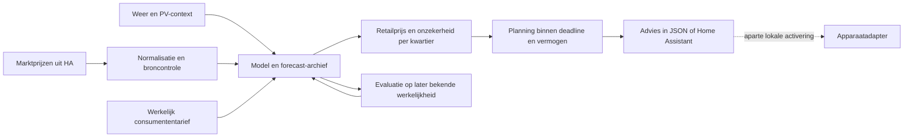

# Van prijs naar energieplan

## Voorspellen

De V11-code behoudt meerdere vergelijkingsmodellen, waaronder weekprofielen,
recente vergelijkbare dagen en combinaties daarvan. Gepubliceerde
day-aheadprijzen vormen het bekende marktdeel; latere uren kunnen een
marktprognose krijgen. De retailmodellen leren de relatie tussen marktprijs en
het werkelijk gemeten consumententarief. De installatie moet hiervoor zelf
voldoende bruikbare historie opbouwen of lokaal importeren.

Een gepubliceerde marktprijs is niet automatisch een bekend all-in
consumententarief: als de retailopslag is geschat, blijft die omzetting onzeker.
Markt-MAE en retail-MAE zijn verschillende grootheden. Een MAE is geen
gegarandeerde bovengrens en geen dekkingspercentage van een betrouwbaarheidsinterval.

Het forecastarchief legt uitgiftemoment en doelmoment vast. Vergelijk een
voorspelling met prijzen die pas later bekend werden; opnieuw voorspellen met
de volledige historie en dat een voorspelling uit het verleden noemen veroorzaakt
informatielekkage. De inbegrepen holdout-/forwardmodules helpen dit onderscheid
te maken; er zijn geen resultaten of modellen van een privé-installatie ingebakken.

## Plannen

Er zijn twee uitdrukkelijk verschillende paden:

| Onderdeel | Bedoeling | Apparaten bedienen |
|---|---|---|
| `planner/energy_planner.py` | Nieuwe algemene referentieplanner voor flexibele verbruikers | Nee |
| `home_assistant/optional/ev_planner.yaml` | Uitgebreid, bestaand EV-patroon met agenda, sessies, deadlines en terugval | Alleen na lokale configuratie en expliciete activering |

De algemene planner sorteert opdrachten op deadline en bij gelijke deadline
op prioriteit. Hij kiest per opdracht een aaneengesloten blok op kwartiergrenzen,
met een naar energie gewogen laatste deel. Eerder geplande opdrachten reserveren
vermogen. Dit is een controleerbare greedy aanpak, geen bewijs van het wereldwijd
goedkoopste gezamenlijke schema.

Bij onvoldoende tijd of ontbrekende prijzen meldt de planner resterende energie
en `emergency_required`. Een gedeeltelijk plan is een waarschuwing; voer het
nooit automatisch uit voor een apparaat dat een volledige cyclus vereist.

Comfort, minimale SOC, benodigde warmte en vorstbescherming moeten uit een
afzonderlijk lokaal model of apparaatbeveiliging komen. Een tijdvenster in een
demonstratie is geen gekalibreerd thermisch model.

## Zonne-energie

Zelf opgewekte stroom heeft een opportuniteitskost: de opbrengst die je mist
door niet terug te leveren. Vergelijk die met een vergelijkbaar later inkooptarief,
rekening houdend met contract, belasting, saldering en voorspellingsonzekerheid.
De PV-helper maakt alleen die vergelijking; hij voorspelt geen fysiek beschikbare
zon en rekent geen universele belasting- of salderingsregels in.
